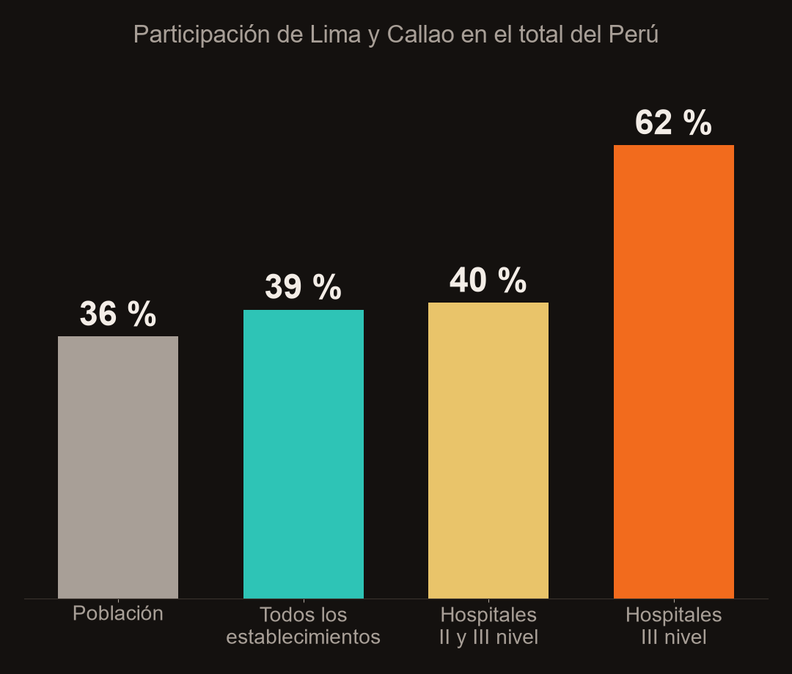

# ¿Dónde te atiendes si te enfermas? La oferta de salud del Perú en datos

**Tarea 3 – Del dato a la historia** · Python Intermedio · Amanda Gomez

| | |
|---|---|
| 🌐 **Dashboard público** | https://av-gomez.github.io/salud-peru-ipress/web/ |
| 🎬 **Reel** | [`reel/salidas/reel.mp4`](reel/salidas/reel.mp4) |
| 💼 **LinkedIn** | _(enlace a la publicación: completar al publicar)_ |
| 📦 **Repositorio** | https://github.com/av-gomez/salud-peru-ipress |

## 1. Tema y pregunta de investigación

**Tema:** oferta de establecimientos de salud (IPRESS) en el Perú y sus brechas territoriales.

**Pregunta:** *¿Cómo se distribuyen los establecimientos de salud en el Perú y la cantidad de locales se traduce en capacidad resolutiva (hospitales de II y III nivel) en cada departamento?*

**Cobertura:** Perú, 25 departamentos. Registro IPRESS del MINSA con corte a septiembre de 2017; población del Censo Nacional 2017 (mismo año, para que los indicadores per cápita sean consistentes).

## 2. Descripción del proyecto

Se limpió el registro de 20 819 establecimientos del MINSA, se clasificó cada uno por nivel de atención y sector, y se cruzó con la población censada para construir indicadores por departamento. Los resultados se presentan en:

- un **dashboard interactivo** (HTML + Plotly.js, GitHub Pages) con 6 KPIs, 6 visualizaciones (2 mapas), 6 controles, buscador y descarga del CSV filtrado;
- un **reel vertical de ~60 s** narrado con mi voz clonada con IA (Qwen3-TTS), con mapas, gráficos, capturas del dashboard, música y subtítulos.


## 3. Fuentes de datos y metodología

| Fuente | Contenido | Enlace | Archivo |
|---|---|---|---|
| MINSA – IPRESS (Plataforma Nacional de Datos Abiertos) | 20 819 establecimientos, 33 variables: institución, categoría, tipo, ubigeo, coordenadas, inicio de actividad… Corte sept. 2017. Descargado el 01/11/2026 | https://www.datosabiertos.gob.pe/dataset/minsa-ipress | `datos/originales/IPRESS.csv` |
| INEI – Censos Nacionales 2017 | Población censada por departamento (total 29 381 884) | https://www.inei.gob.pe/media/MenuRecursivo/publicaciones_digitales/Est/Lib1544/ | `datos/originales/poblacion_inei_2017.csv` |
| Límites departamentales (base INEI) | GeoJSON de 25 departamentos | https://github.com/juaneladio/peru-geojson | `datos/originales/peru_departamental.geojson` |

**Procesamiento** (`scripts/procesar_datos.py`):

1. Lectura en `latin1`, normalización de nombres de columnas y de departamentos (sin tildes).
2. **Limpieza:** se eliminan 12 registros con `Código Único` duplicado y 19 establecimientos que no están «EN FUNCIONAMIENTO» (inoperativos, cierre temporal, restricción) → **20 774** establecimientos.
3. **Coordenadas:** las columnas `NORTE`/`ESTE` vienen rotuladas al revés (NORTE es longitud, ESTE latitud); se corrigen y se descartan puntos fuera del Perú → 7 927 georreferenciados (38 %).
4. **Variables derivadas:** nivel de atención (I-1…I-4 = I nivel; II-1, II-2, II-E = II; III-1, III-2, III-E = III; resto «Sin categoría»), sector (Privado; MINSA/Gob. regional; EsSalud; FF.AA. y Policía; otros públicos), año de inicio de actividad.
5. **Indicadores por departamento** (`datos/procesados/departamentos.csv`): establecimientos por 10 000 hab., hospitales II–III por 100 000 hab., % privados, % de públicos que son I-1, habitantes por establecimiento.
6. Exportación compacta para la web (`web/data/ipress.json`, `resumen.json`). El dashboard recalcula todo en el navegador según los filtros.

## 4. Hallazgos principales

1. **La alta complejidad se concentra en la capital.** Lima y Callao tienen el 35,7 % de la población y el 39,4 % de los establecimientos, pero el **61,8 % de los hospitales de III nivel (34 de 55)**. **16 de 25 departamentos** no registran ningún establecimiento de III nivel.
2. **Más locales no significa más capacidad.** Amazonas (13,9), Huancavelica (13,1) y Tacna (12,7) tienen la mayor densidad de establecimientos por 10 000 hab., casi el doble del promedio nacional (7,1). Pero en Amazonas el **72 % de los establecimientos públicos son puestos I-1**, la categoría más básica. La correlación entre densidad de establecimientos y hospitales II–III por habitante es apenas **0,15**.
3. **El crecimiento reciente fue privado.** El **89,6 %** de los establecimientos que iniciaron actividad entre 2008 y 2017 son privados (sobre todo consultorios). Los públicos dominan en las regiones: en Ayacucho, Pasco y Amazonas los privados son menos del 7 %, frente al 88 % en Lima.



## 5. Limitaciones

- El registro es una **foto de septiembre de 2017**; la red de salud cambió desde entonces (por ejemplo, después de la pandemia). La caída de altas en 2017 se debe a que el año está incompleto.
- Contar locales no mide **personal, camas, horarios ni equipamiento**; el campo `CAMAS` solo está lleno en 630 filas, por eso no se usa como indicador.
- El **28 %** de los establecimientos no tiene categoría (sobre todo consultorios privados y servicios médicos de apoyo).
- El año de inicio es el declarado en el registro, no necesariamente la fecha real de apertura.
- Solo el **38 %** tiene coordenadas: el mapa de puntos no es exhaustivo (los indicadores sí usan los 20 774).
- Los indicadores per cápita usan la población censada 2017 por departamento; Lima incluye Lima Metropolitana y Lima provincias.

## 6. Enlaces

- Dashboard: https://av-gomez.github.io/salud-peru-ipress/web/
- LinkedIn: _(completar con el enlace de la publicación)_

## 7. Reproducir

```bash
# 1. datos e indicadores
pip install -r requirements.txt
python scripts/procesar_datos.py          # -> datos/procesados/ y web/data/

# 2. dashboard (servidor local)
cd web && python -m http.server 8000      # abrir http://localhost:8000

# 3. reel
python reel/visuales.py                   # fondos de cada escena (reel/visuales/)
cd reel
python -m venv .venv && .venv/Scripts/pip install qwen-tts faster-whisper pillow imageio-ffmpeg soundfile jiwer num2words
.venv/Scripts/python musica.py            # música de fondo original
.venv/Scripts/python hacer_reel.py --voz mi_voz.m4a --autor "Amanda Gomez" --fuente "MINSA (IPRESS) e INEI (Censo 2017)"
.venv/Scripts/python mezclar_musica.py    # mezcla la música bajo la voz -> salidas/reel.mp4
```

Estructura:

```text
datos/originales/   IPRESS.csv, poblacion_inei_2017.csv, peru_departamental.geojson
datos/procesados/   ipress_limpio.csv, departamentos.csv
scripts/            procesar_datos.py
web/                index.html (dashboard), data/
reel/               guion.json, hacer_reel.py, visuales.py, musica.py, mezclar_musica.py,
                    visuales/, recursos/, salidas/ (reel.mp4, reel.srt, portada.png)
```

## 8. Uso de inteligencia artificial

- **Claude Code (Anthropic)** se usó para descargar los datos, escribir el código de limpieza y análisis, construir el dashboard y el pipeline del reel. Todas las cifras del README, dashboard y guion se verificaron contra `web/data/resumen.json`, generado por `scripts/procesar_datos.py`.
- **Qwen3-TTS-12Hz-0.6B-Base** generó la narración clonando **mi propia voz** a partir de una grabación de ~20 s (la grabación no se sube al repositorio).
- **faster-whisper (small)** transcribió la narración para sincronizar los subtítulos y controlar la pronunciación.
- La música es una pista original sintetizada con `reel/musica.py` (sin derechos de terceros). Los mapas y gráficos se generaron con matplotlib a partir de los datos.
- El video muestra durante todo el reel el aviso «Voz generada con IA» y la fuente de los datos.
