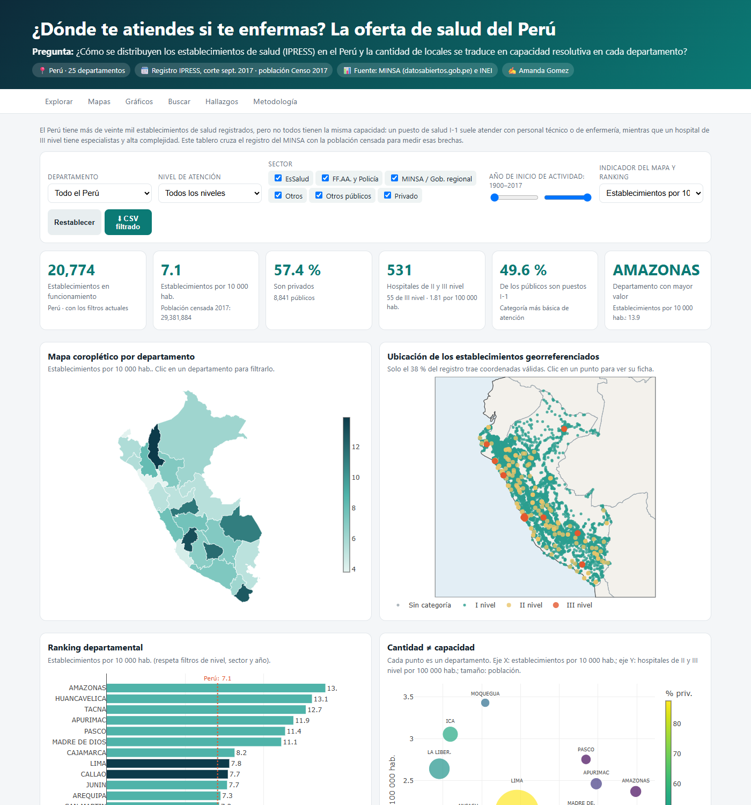
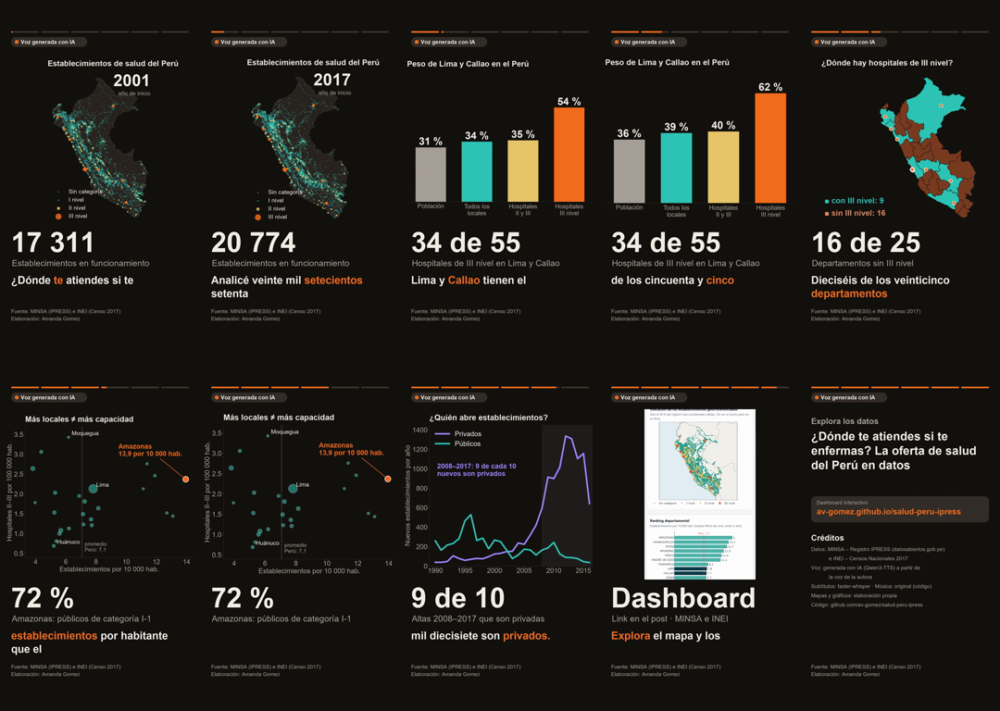
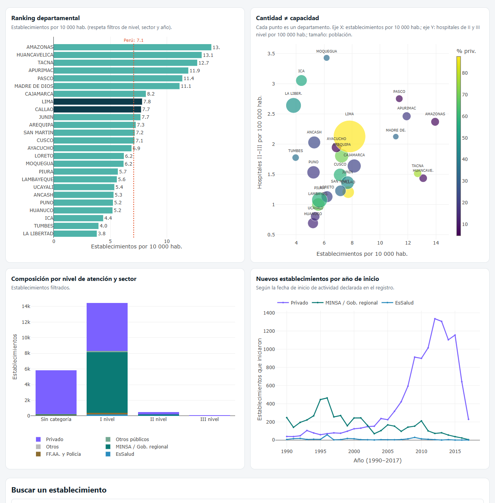

# ¿Dónde te atiendes si te enfermas? La oferta de salud del Perú en datos

**Tarea 3 – Del dato a la historia** · Python Intermedio · Amanda Gomez

| | |
|---|---|
| 🌐 **Dashboard público** | https://av-gomez.github.io/salud-peru-ipress/web/ |
| 🎬 **Reel (54 s, 9:16)** | [`reel/reel.mp4`](reel/reel.mp4) · subtítulos [`reel/subtitulos.srt`](reel/subtitulos.srt) |
| 💼 **LinkedIn** | https://lnkd.in/p/d-AdiBHQ |
| 📦 **Repositorio** | https://github.com/av-gomez/salud-peru-ipress |



## 1. Tema y pregunta de investigación

**Tema:** oferta de establecimientos de salud (IPRESS) en el Perú y sus brechas territoriales.

**Pregunta:** *¿Cómo se distribuyen los establecimientos de salud en el Perú y la cantidad de locales se traduce en capacidad resolutiva (hospitales de II y III nivel) en cada departamento?*

**Cobertura:** Perú, 25 departamentos (Lima y Callao por separado). Registro IPRESS del MINSA con corte a septiembre de 2017 y población del Censo Nacional 2017: se usa el mismo año en el numerador y en el denominador para que los indicadores per cápita sean consistentes.

## 2. Descripción del proyecto

Se limpió el registro de **20 819** establecimientos del MINSA, se clasificó cada uno por nivel de atención y sector, y se cruzó con la población censada para construir indicadores por departamento. Los resultados se comunican en dos productos:

- **Dashboard interactivo** (HTML + Plotly.js, publicado en GitHub Pages, adaptado a celulares):
  - 6 KPIs que se recalculan con los filtros: total de establecimientos, establecimientos por 10 000 hab., % privados, hospitales de II–III nivel, % de públicos que son I-1 y departamento con mayor valor.
  - 6 visualizaciones: mapa coroplético por departamento, mapa de puntos por nivel, ranking departamental, dispersión densidad vs. capacidad, composición por nivel y sector, y serie de aperturas por año.
  - 7 controles: departamento (también con clic en el mapa), nivel de atención, sector, rango de años, indicador del mapa y ranking, buscador por nombre, distrito o provincia, y descarga del CSV filtrado.
  - Secciones de hallazgos, metodología, fuentes y limitaciones.
- **Reel vertical de 54 s** (1080 × 1920) narrado con **mi voz clonada con IA** (Qwen3-TTS). Tiene 6 escenas con mapas y gráficos animados, una captura del dashboard en celular, música original más baja que la voz, subtítulos sincronizados palabra por palabra, el aviso «Voz generada con IA» todo el tiempo y una tarjeta final de créditos y fuentes.



## 3. Fuentes de datos y metodología

| Fuente | Contenido | Enlace | Archivo |
|---|---|---|---|
| MINSA – IPRESS (Plataforma Nacional de Datos Abiertos) | 20 819 establecimientos, 33 variables (institución, categoría, tipo, ubigeo, coordenadas, inicio de actividad…). Corte sept. 2017. Descargado el 01/11/2026 | https://www.datosabiertos.gob.pe/dataset/minsa-ipress | `datos/originales/IPRESS.csv` |
| INEI – Censos Nacionales 2017: Resultados definitivos | Población censada por departamento (total 29 381 884) | https://www.inei.gob.pe/media/MenuRecursivo/publicaciones_digitales/Est/Lib1544/ | `datos/originales/poblacion_inei_2017.csv` |
| Límites departamentales (base INEI) | GeoJSON de 25 departamentos | https://github.com/juaneladio/peru-geojson | `datos/originales/peru_departamental.geojson` |

**Flujo** (`scripts/`):

1. **`obtener_datos.py`**: descarga el CSV del MINSA y el GeoJSON. El portal de datos abiertos responde HTTP 418 si la petición no lleva el User-Agent de un navegador, así que se envía uno.
2. **`procesar_datos.py`**: limpieza y construcción de indicadores.
   - Lee en `latin1` y normaliza nombres de columnas y de departamentos (sin tildes).
   - **Limpieza:** elimina 12 registros con `Código Único` duplicado y 19 establecimientos que no están «EN FUNCIONAMIENTO» (inoperativos, en cierre temporal o con restricción). Quedan **20 774** (`datos/procesados/limpieza.json`).
   - **Coordenadas:** las columnas `NORTE`/`ESTE` vienen rotuladas al revés (NORTE es la longitud y ESTE la latitud). Se corrigen y se descartan los puntos fuera del Perú: quedan 7 927 georreferenciados (38 %).
   - **Variables derivadas:**
     - Nivel de atención: I-1 a I-4 → I nivel; II-1, II-2 y II-E → II; III-1, III-2 y III-E → III; el resto → «Sin categoría».
     - Sector: privado; MINSA/gobierno regional; EsSalud; FF.AA. y Policía; otros públicos.
     - Año de inicio de actividad.
   - **Indicadores por departamento** (`datos/procesados/departamentos.csv`): establecimientos por 10 000 hab., hospitales II–III por 100 000 hab., % privados, % de públicos que son I-1 y habitantes por establecimiento.
   - Exporta los datos en formato compacto para la web (`web/data/ipress.json`).
3. **`analizar_datos.py`**: calcula los hallazgos y los guarda en `web/data/resumen.json`. Todas las cifras del dashboard, de este README y del guion del reel salen de ese archivo.

El dashboard recalcula los KPIs, los mapas y los gráficos en el navegador a partir de los 20 774 registros, según los filtros elegidos.

## 4. Hallazgos principales

1. **La alta complejidad se concentra en la capital.** Lima y Callao tienen el 35,7 % de la población y el 39,4 % de los establecimientos, pero el **61,8 % de los hospitales de III nivel (34 de 55)**. **16 de 25 departamentos** no registran ningún establecimiento de III nivel.
2. **Más locales no significa más capacidad.** Amazonas (13,9), Huancavelica (13,1) y Tacna (12,7) tienen la mayor densidad de establecimientos por 10 000 hab., casi el doble del promedio nacional (7,1). Pero en Amazonas el **72 % de los establecimientos públicos son puestos I-1**, la categoría más básica. La correlación entre la densidad de establecimientos y los hospitales II–III por habitante es apenas **0,15**.
3. **El crecimiento reciente fue privado.** El **89,6 %** de los establecimientos que iniciaron actividad entre 2008 y 2017 son privados, sobre todo consultorios. En las regiones dominan los públicos: en Ayacucho, Pasco y Amazonas los privados son menos del 7 %, frente al 88 % en Lima.



## 5. Limitaciones

- El registro es una **foto de septiembre de 2017**; la red de salud cambió desde entonces (por ejemplo, después de la pandemia). La caída de aperturas en 2017 se debe a que ese año está incompleto.
- Contar locales no mide **personal, camas, horarios ni equipamiento**. El campo `CAMAS` solo está lleno en 630 filas, por eso no se usa como indicador.
- El **28 %** de los establecimientos no tiene categoría, sobre todo consultorios privados y servicios médicos de apoyo.
- El año de inicio es el declarado en el registro, no necesariamente la fecha real de apertura.
- Solo el **38 %** tiene coordenadas, así que el mapa de puntos no es exhaustivo. Los indicadores y el mapa coroplético sí usan los 20 774 registros.
- Los indicadores per cápita usan la población censada 2017 por departamento; Lima incluye Lima Metropolitana y Lima provincias.
- Es un análisis descriptivo: muestra brechas de oferta, no causas ni resultados de salud.

## 6. Enlaces

- Dashboard: https://av-gomez.github.io/salud-peru-ipress/web/
- Publicación de LinkedIn: https://lnkd.in/p/d-AdiBHQ
- Reel: [`reel/reel.mp4`](reel/reel.mp4)

## 7. Reproducir

```bash
# 1. datos, indicadores y hallazgos
pip install -r requirements.txt
python scripts/obtener_datos.py           # -> datos/originales/
python scripts/procesar_datos.py          # -> datos/procesados/ y web/data/ipress.json
python scripts/analizar_datos.py          # -> web/data/resumen.json

# 2. dashboard en local
cd web && python -m http.server 8000      # abrir http://localhost:8000

# 3. reel (desde la raíz; la voz necesita un entorno aparte)
python reel/visuales.py                   # mapas y gráficos animados -> reel/visuales/
cd reel
python -m venv .venv && .venv/Scripts/pip install -r requirements.txt
.venv/Scripts/python musica.py            # música de fondo original -> recursos/musica.wav
.venv/Scripts/python hacer_reel.py --voz mi_voz.m4a --voz-inicio 0.5 --voz-fin 19.25 \
    --texto-voz "$(cat voz_ref.txt)" --autor "Amanda Gomez" --fuente "MINSA (IPRESS) e INEI (Censo 2017)"
.venv/Scripts/python mezclar_musica.py    # música bajo la voz -> reel/reel.mp4 y reel/subtitulos.srt
```

`hacer_reel.py` hace cuatro cosas:

1. Recorta de mi grabación un tramo limpio de 18,75 s que termina al final de una frase y le pasa al modelo su texto exacto (`voz_ref.txt`).
2. Genera cada escena con Qwen3-TTS.
3. Escucha cada escena con Whisper y la vuelve a generar si el error de palabras (WER) supera el 25 %.
4. Compone el video con Pillow y ffmpeg: animaciones, fundidos, barra de progreso, subtítulos palabra por palabra y créditos.

En una laptop sin GPU tarda unos 12 min.

Estructura:

```text
datos/originales/   IPRESS.csv, poblacion_inei_2017.csv, peru_departamental.geojson
datos/procesados/   ipress_limpio.csv, departamentos.csv, limpieza.json
scripts/            obtener_datos.py, procesar_datos.py, analizar_datos.py
web/                index.html (dashboard), data/ (ipress.json, resumen.json, peru.geojson), assets/
reel/               reel.mp4, subtitulos.srt, guion.json, hacer_reel.py, visuales.py, musica.py,
                    mezclar_musica.py, recursos/ (capturas, música), salidas/ (portada)
```

## 8. Uso de inteligencia artificial

- **Claude Code (Anthropic)** se usó para descargar los datos, escribir el código de limpieza y análisis, construir el dashboard y el pipeline del reel. Las cifras del README, el dashboard y el guion se verificaron contra `web/data/resumen.json`, que genera `scripts/analizar_datos.py`.
- **Qwen3-TTS-12Hz-0.6B-Base** generó la narración clonando **mi propia voz** a partir de una grabación mía de 18,75 s. La grabación no se sube al repositorio.
- **faster-whisper (small)** transcribió la narración para sincronizar los subtítulos y controlar la pronunciación de las cifras.
- La música es una pista original sintetizada con `reel/musica.py`, sin derechos de terceros. Los mapas y gráficos son de elaboración propia (matplotlib) a partir de los datos.
- El video muestra todo el tiempo el aviso «Voz generada con IA», la fuente de los datos y, al final, los créditos.
